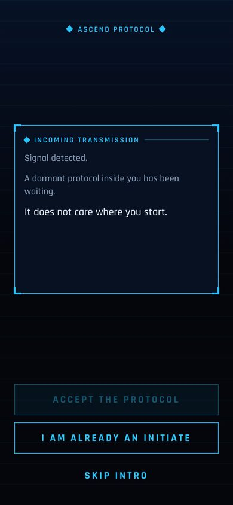
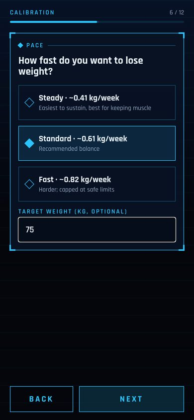
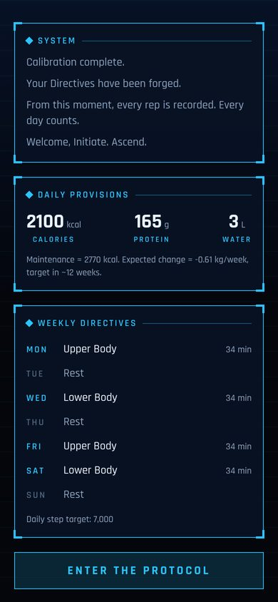
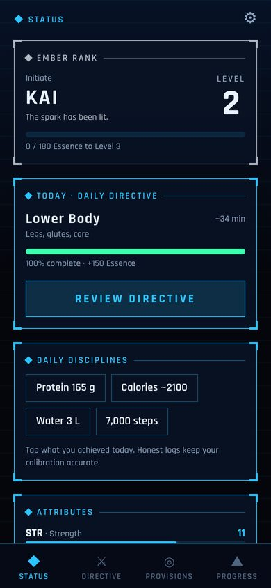
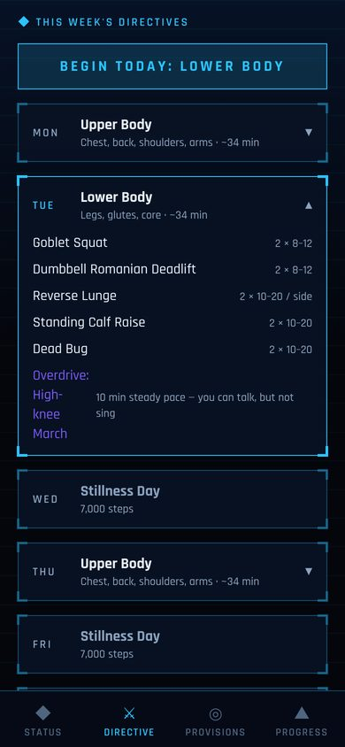
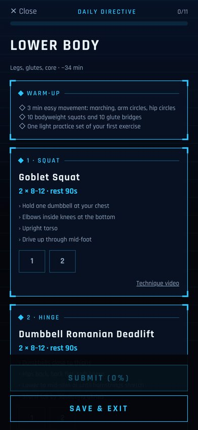
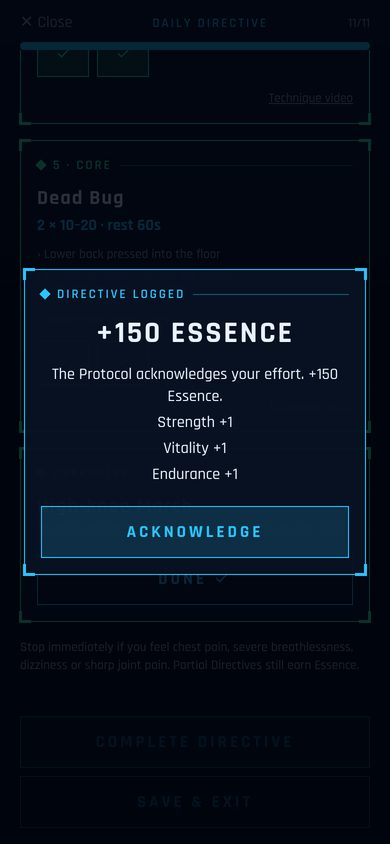
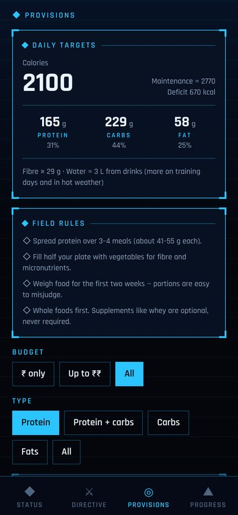

# Ascend Protocol

**A fitness app that treats your life like an RPG.** A mysterious "Protocol" calibrates you with a questionnaire, builds a personal workout and nutrition plan, and then levels you up as you complete your Daily Directives. It is inspired by game-system anime, with an original story, ranks and look (see [docs/LEGAL.md](docs/LEGAL.md)).

<p>




</p>
<p>




</p>

## Features

- **Calibration (onboarding):** name, sex, age, height and weight (metric or imperial), daily activity, goal (lose weight / gain weight & muscle / stay fit), pace and target weight, experience, equipment, **which weekdays you train**, session length, diet (veg / egg / non-veg / vegan), and a PAR-Q-style health screening with consent.
- **Personal plan:** a weekly split (full body, upper/lower or push/pull/legs) built only from exercises your equipment allows. It includes sets, reps, rest, form cues, a warm-up and a conditioning finisher for fat loss. A gentle mode switches on automatically after any health-screening "yes" or for users 65+.
- **Workout player:** tap sets as you go, with automatic rest timers, hold timers, technique-video links, and partial credit for partial sessions.
- **Nutrition:** daily calories, protein, carbs, fat, fibre and water from evidence-based formulas. Safety rules:
  - calorie floors, a deficit cap and a BMI check;
  - no dieting for minors, during pregnancy, or with a history of eating disorders;
  - adjusted protein for kidney disease.
- **Provisions:** foods ranked from cheapest (₹) to premium (₹₹₹) and filtered by your diet, including soya chunks, peanuts, eggs, dal, paneer, tofu, chicken and whey. Values come from USDA data.
- **RPG layer:**
  - Essence (XP), levels and six ranks (Ember → Ascendant);
  - five attributes (STR/END/AGI/VIT/DIS);
  - a streak "Chain";
  - level-up and rank-up System alerts.
- **3-week Calibration:** optional weigh-in. It shows your change since the start and since the last check-in, compares it with your plan, recalibrates your real maintenance calories from your data, and lets you go **faster / slower / keep the pace** within safe limits.
- **Notifications:** morning Directive, an evening reminder only if you haven't trained yet, Stillness (rest) days, check-in due, and a warning before the free days end. All text is in the app's story style.
- **Subscription:** 9 free days, then subscribe on day 10 with a **6-day free trial**, so the first charge is on day 16 (15 free days in total). Uses Google Play Billing with server verification and real-time notifications.
- **Accounts:** email/password, password reset by emailed code, refresh-token rotation, and account deletion.

## Architecture

```
packages/core   Shared TypeScript logic (no UI, no DB): nutrition, foods, exercises, plan generator,
                XP/ranks/streaks, access timeline, check-ins, story text, validation. Fully unit-tested.
server          Node.js + Express 5 API, PostgreSQL via Drizzle ORM, JWT auth, Google Play
                Developer API + Pub/Sub notifications. Integration-tested against real Postgres (PGlite).
app             Expo SDK 58 / React Native (expo-router). Android-first; iOS builds work except billing.
docs            Research sources, legal/IP notes, Play Store guide, privacy policy template.
```

The app and server use the **same** `@ascend/core` code, so calorie and XP numbers can never disagree between them.

## Quick start (no Docker needed)

Requirements: Node 20+ and npm. For a phone: the **Expo Go** app or an Android emulator.

```bash
npm install
npm run dev:lite          # API on http://localhost:4000 with an embedded Postgres + mock billing
```

In a second terminal:

```bash
cp app/.env.example app/.env
# Android emulator: keep EXPO_PUBLIC_API_URL=http://10.0.2.2:4000
# Physical phone: use your computer's LAN IP, e.g. http://192.168.1.20:4000
npm run app:start         # press "a" for Android, or scan the QR code
```

Mock billing lets you test the paywall without Google Play. In-app purchases need a development or production build (`eas build`), not Expo Go. Password-reset codes are printed in the API terminal until SMTP is configured.

### With a real Postgres

```bash
cp server/.env.example server/.env    # set JWT_SECRET
npm run db:up                         # Postgres 17 in Docker
npm run db:migrate
npm run server:dev
```

Or run everything in Docker with `docker compose up --build`.

## Tests and checks

```bash
npm test          # core unit tests + API integration tests
npm run typecheck # core, server and app
```

The integration test walks through the whole journey:
- register, onboard, log workouts and habits;
- **day 9 free → day 10 locked**;
- subscribe via Google Play (trial), then process renewal and expiry notifications;
- a 3-week check-in and a pace change;
- password reset and account deletion.

## Deploying

- **API:** any Node host with HTTPS plus managed Postgres (e.g. Render, Railway, Fly.io, Google Cloud Run + Cloud SQL, Supabase). Set the variables from `server/.env.example`. `server/Dockerfile` runs migrations, then starts the API.
- **App:** EAS Build → Google Play. Follow [docs/PLAY_STORE.md](docs/PLAY_STORE.md) step by step: subscription product, trial offer, service account, notifications, testing and compliance.

## Before you publish

1. Have a **dietitian and a strength coach** review `packages/core` (see [docs/RESEARCH.md](docs/RESEARCH.md)).
2. Have a **lawyer** check the name and store listing (see [docs/LEGAL.md](docs/LEGAL.md)).
3. Publish a **privacy policy** (template in [docs/PRIVACY_POLICY.md](docs/PRIVACY_POLICY.md)) and set `EXPO_PUBLIC_PRIVACY_URL`.
4. Configure **SMTP** (`SMTP_URL`) so password-reset emails are delivered.

## Known limitations

- Subscriptions are implemented for **Google Play only**. iOS would need App Store products and server verification.
- The app needs an internet connection: progress is stored on the server.
- Food prices are shown as relative tiers, not exact prices.
- English only for now. All story text is in `packages/core/src/lore.ts`, ready for translation.
